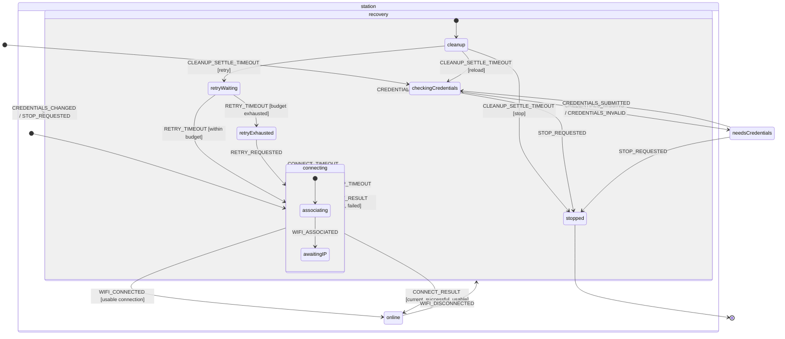

# Initial Wi-Fi Statechart

Status: proposed initial design contract based on the first accepted physical
Wi-Fi event-characterisation results. It is suitable for the Phase 2 minimal
actor vertical slice, but its timing and retry policy remain provisional until
repeatability review is complete.

This document defines the first XFSM model for Wi-Fi connection ownership on
the Seeed Studio XIAO ESP32C3. It describes state and event meaning rather than
an expected native-event sequence. The physical evidence is retained under
[`test-results/wifi-event-characterisation/`](test-results/wifi-event-characterisation/).

The machine follows the three-layer boundary in
[`requirements.md`](requirements.md): ordinary functions perform effects,
native services and timers generate events, and the XFSM actor alone selects
connection policy.

## Scope

The initial machine covers:

- actor startup and explicit credential loading;
- missing or invalid credentials;
- one native station connection attempt at a time;
- association and IP-ready connection status;
- connection timeout and native failure;
- unexpected connection loss;
- explicit native cleanup before retry;
- controlled retry delay and exhaustion;
- graceful stop and XFSM actor lifecycle; and
- a stable status contract for later HTTP and heater consumers.

The initial machine does not implement:

- provisioning AP or HTTP services;
- network scanning or credential submission persistence;
- final retry/backoff or credential-usability policy;
- DS18B20, Shelly, or heater behaviour; or
- automatic restoration of an XFSM history state.

Provisioning will later refine `needsCredentials` and may add transitions from
`retryExhausted`. It must not bypass this actor to call `wifi.connect()`.

## Evidence Behind The Model

The following observations constrain the initial design:

- A normal connection emitted `associated`, then `connected` with an assigned
  IP, then a successful connect callback. Immediately after `associated`,
  `wifi.getDetails()` reported `connected` while the IP was still `0.0.0.0`.
- Incorrect credentials and an unavailable network emitted `disconnected`
  without ever establishing a usable connection. `WIFI_DISCONNECTED` therefore
  means different things in `connecting` and `online`.
- AP loss cleared IP state and later emitted `disconnected`. Restoring the AP
  caused no event and no automatic reconnection during the observation period.
- A deliberate disconnect callback fired twice, with the native disconnect
  event between its two invocations.
- An application timeout did not cancel native connection work. Starting a new
  attempt without cleanup produced `ESP_ERR_WIFI_STATE`, returned normally to
  JavaScript, and could leave both attempts callback-silent.
- Explicit disconnect terminated timed-out native work. Its first callback was
  followed by the native disconnect event, the original connect callback, and
  a second disconnect callback. A later connection then succeeded.
- Native event payloads do not carry the application attempt generation used
  by callbacks and timers.

These are observations from accepted initial runs, not universal ordering or
timing guarantees. See the individual `findings.md` files for limitations and
exact timings.

## Profile 2 Modelling Constraints

The design uses only the supported Profile 2 single-active-branch model.

- Native timers implement timeout occurrences and send ordinary events;
  delayed transitions are not used.
- Native Wi-Fi work is managed by actions and event generators; invoked
  services and spawned actors are not used.
- Child states omit common handlers so event lookup deliberately falls back to
  their compound parent.
- Targetless transitions record duplicate, stale, or intermediate occurrences
  without leaving and re-entering hardware-owning states.
- A top-level final state represents graceful completion. An explicit
  `actor.stop()` and an actor fault remain separate XFSM lifecycle paths.
- History is deliberately not used. Restoring a remembered `online` state
  would not prove that the native driver still has a usable connection.

## Proposed Statechart

The Mermaid diagram is conceptual. In the executable definition, targets that
cross compound-state boundaries will use unambiguous relative paths or
explicit state IDs supported by XFSM.

## State Contract

### `checkingCredentials`

Purpose: establish the application configuration before any connection is
started.

Entry responsibilities:

- schedule credential loading from Espruino `Storage`;
- validate only the record structure needed to classify it; and
- deliver the result later as `CREDENTIALS_AVAILABLE`,
  `CREDENTIALS_MISSING`, or `CREDENTIALS_INVALID`.

The load action must not synchronously call `actor.send()` from the entry
action. Password data is not copied into XFSM context or snapshots.

### `needsCredentials`

Purpose: represent a safe non-connecting state when configuration is absent or
invalid.

No station connection timer or retry timer may be active. Phase 5 will refine
this state into provisioning service states. Until then it accepts a later
configuration notification or graceful stop.

### `station`

Purpose: parent for configured station-mode lifecycle. It provides shared
handling for `STOP_REQUESTED` and `CREDENTIALS_CHANGED` without duplicating
those transitions in every child. Their transition actions select `stop` or
`reloadCredentials` as the cleanup purpose before entering recovery.

Entering `station` does not itself call the driver. Its initial descent enters
`connecting`, whose entry actions own the connection attempt.

### `station.connecting`

Purpose: own exactly one native `wifi.connect()` operation and its application
timeout.

Entry responsibilities, in order:

1. assign a new monotonically increasing `attemptId` and clear per-attempt
   observations;
2. arm the connection timer for that `attemptId`; and
3. call the Wi-Fi connection action using credentials held by the configuration
   service.

Exit responsibilities:

- cancel the connection timer owned by the current attempt; and
- prevent its timer handle from being reused by a later attempt.

Operational driver errors should be caught by the action and delivered later
as `CONNECT_RESULT`; an escaping programming or invariant error is allowed to
fault the actor according to the XFSM contract.

`WIFI_CONNECTED`, `CONNECT_RESULT`, `CONNECT_TIMEOUT`,
`WIFI_DHCP_TIMEOUT`, and connection-failure handling belong on this compound
parent. The active child therefore falls back to one shared policy definition.
`WIFI_DISCONNECTED` is a targetless parent handler here: it records the native
failure but waits for the current connect result or application timeout to
select cleanup policy.

#### `station.connecting.associating`

Purpose: the native attempt has started but no association notification has
been accepted.

`WIFI_ASSOCIATED` records the supplied details and moves to `awaitingIP`.
`WIFI_CONNECTED` may still be handled by the `connecting` parent from this
state; the machine does not require the observed association event to arrive
first in every run.

#### `station.connecting.awaitingIP`

Purpose: association has been observed, but usable network readiness has not.

This state must not publish `online` merely because
`wifi.getDetails().status` says `connected`. Readiness requires a current
successful result or native connected event reconciled with a usable IP and
the configured network.

### `station.online`

Purpose: publish that station connectivity is usable by application
components.

Entry responsibilities:

- record the connected network details and monotonic connection-start time;
- clear connection-failure status; and
- reset the automatic retry count according to the provisional policy.

Exit responsibilities:

- clear current IP readiness and connection uptime from the public status; and
- retain the last successful and disconnect information for diagnostics.

A `WIFI_DISCONNECTED` here represents loss of an established connection,
unlike the same native event while `connecting`. It begins recovery. Repeated
or late successful callbacks are observations only and must not create a
second policy transition.

### `station.recovery`

Purpose: parent for the controlled path between a failed/lost connection and a
new attempt. It groups cleanup, retry delay, and exhausted policy without
allowing them to be mistaken for online status.

Any `WIFI_CONNECTED` received in this subtree is unexpected or late. It must be
recorded and reconciled, but it must not transition directly to `online`.

#### `station.recovery.cleanup`

Purpose: make native connection work quiescent before retry, credential reload,
or graceful stop.

Entry responsibilities:

1. cancel any connection and retry timers;
2. assign a new `cleanupId`;
3. issue at most one native disconnect request for that cleanup generation;
4. set `cleanupPurpose` to `retry`, `reloadCredentials`, or `stop`; and
5. arm the cleanup quiet timer.

The state consumes these occurrences without treating any single one as proof
of completion:

- `WIFI_DISCONNECTED`;
- late `CONNECT_RESULT`;
- `DISCONNECT_RESULT`, including duplicates; and
- unexpected `WIFI_ASSOCIATED` or `WIFI_CONNECTED`.

Each current cleanup-related occurrence updates observations and restarts the
quiet timer. A `CLEANUP_SETTLE_TIMEOUT` may leave cleanup only when its
`cleanupId` is current and its attached driver/IP observation satisfies the
provisional quiescence guard. Its destination is selected by
`cleanupPurpose`.

The first disconnect callback is explicitly not a cleanup-complete event.

#### `station.recovery.retryWaiting`

Purpose: make retry policy visible and prevent an immediate uncontrolled loop.

Entry arms one retry timer with a new `retryGeneration`; exit cancels it. A
current `RETRY_TIMEOUT` starts a fresh connection only when the automatic retry
budget permits it. Otherwise it enters `retryExhausted`.

Late native activity in this state returns to cleanup rather than being
accepted as a new connection.

#### `station.recovery.retryExhausted`

Purpose: remain configured but offline after the provisional automatic retry
budget is exhausted.

No connection or retry timer is active. `RETRY_REQUESTED` permits an explicit
new attempt. Phase 5 may add a guarded transition to provisioning, but the
initial model does not equate network absence with invalid credentials.

### `stopped`

Purpose: top-level final state reached after graceful cleanup, or directly
when stopping before station work begins.

Reaching this state completes the actor. Root exit actions remove native Wi-Fi
listeners and cancel any remaining application timers.

Direct `actor.stop()` remains supported for owner-initiated immediate
termination. It executes active exit actions synchronously, but it cannot wait
for asynchronous Wi-Fi cleanup callbacks. The application owner must therefore
prefer `STOP_REQUESTED` for graceful shutdown and reserve `actor.stop()` for
forced teardown.

## Event Contract

Every event is an object with a non-empty `type`. String-only events are not
used by this application boundary because correlation and observation fields
are important.

### Configuration events

| Event | Required fields | Meaning |
| --- | --- | --- |
| `CREDENTIALS_AVAILABLE` | `revision`, `ssid` | A validated configuration record is available through the configuration service. |
| `CREDENTIALS_MISSING` | none | No stored credential record exists. |
| `CREDENTIALS_INVALID` | `reason` | A stored record exists but fails structural validation. |
| `CREDENTIALS_SUBMITTED` | implementation deferred | A provisioning client submitted a candidate configuration. |
| `CREDENTIALS_CHANGED` | `revision`, `ssid` | A newer validated configuration must replace the current one after cleanup. |

Passwords must not be placed in events retained by logs, context, snapshots,
or HTTP responses. The connection action obtains the secret from the
configuration service using the current revision.

### Native Wi-Fi events

| Event | Required fields | Meaning |
| --- | --- | --- |
| `WIFI_ASSOCIATED` | `details`, `observed` | Translation of native `associated`. |
| `WIFI_CONNECTED` | `details`, `observed` | Translation of native `connected`; readiness still requires reconciliation. |
| `WIFI_DISCONNECTED` | `details`, `observed` | Translation of native `disconnected`; interpretation depends on active state. |
| `WIFI_DHCP_TIMEOUT` | `details`, `observed` | Translation of native `dhcp_timeout`; physically unobserved so far. |

`observed` contains sanitised `wifi.getDetails()` and `wifi.getIP()` facts
captured near event ingress. Native events must not be assigned an
`attemptId` merely because an attempt happens to be current; the native API
does not provide that correlation.

### Operation-result events

| Event | Required fields | Meaning |
| --- | --- | --- |
| `CONNECT_RESULT` | `attemptId`, `error`, `details`, `observed` | Result callback for one application-issued connect operation. |
| `DISCONNECT_RESULT` | `cleanupId`, `callbackCount`, `observed` | One callback invocation for a cleanup request. Duplicate invocations are allowed. |

Callbacks capture their application generation when the operation is issued.
A callback with a stale generation may update bounded diagnostics but must not
change current connection policy.

### Timer events

| Event | Required fields | Meaning |
| --- | --- | --- |
| `CONNECT_TIMEOUT` | `attemptId`, `observed` | The application attempt deadline expired; native work may still be active. |
| `CLEANUP_SETTLE_TIMEOUT` | `cleanupId`, `observed` | The cleanup quiet interval expired and current driver/IP facts are available for guards. |
| `RETRY_TIMEOUT` | `retryGeneration` | The controlled retry delay expired. |

Timer handles are service-owned resources, while their generation numbers are
actor context. A timer event from an old generation is consumed without a
state transition.

### Command events

| Event | Required fields | Meaning |
| --- | --- | --- |
| `RETRY_REQUESTED` | optional `source` | An operator or later HTTP handler requests another attempt. |
| `STOP_REQUESTED` | optional `reason` | The owner requests graceful cleanup and completion. |

Command producers request policy through the actor. They do not call the Wi-Fi
driver directly.

## Context Contract

The machine uses a context factory so every actor receives an independent
object graph. Context is replaced through `XFSM.assign(...)`; actions and
external consumers do not mutate snapshots or nested context values.

| Field | Purpose |
| --- | --- |
| `credentialStatus` | `unknown`, `available`, `missing`, or `invalid`. |
| `credentialRevision` | Identifies the external configuration version without containing its password. |
| `configuredSsid` | SSID permitted for public status display. |
| `attemptId` | Monotonic identity for application callbacks and connect timers. |
| `cleanupId` | Monotonic identity for one cleanup lifecycle. |
| `cleanupPurpose` | `retry`, `reloadCredentials`, or `stop`. |
| `retryGeneration` | Identity for the current retry timer. |
| `retryCount` | Number of consecutive automatic attempts since the last usable connection. |
| `associated` | Whether association has been observed for the current attempt. |
| `ip`, `netmask`, `gateway` | Current reconciled network facts; cleared outside `online`. |
| `connectedSince` | Monotonic timestamp set on entry to `online`. |
| `lastDisconnectReason` | Most recent native reason code/message, retained for status. |
| `lastFailure` | Bounded sanitised description of the most recent failed attempt. |
| `driverStatus` | Last observed native status string; diagnostic fact, not FSM authority. |

Timer handles, listener functions, native callback functions, and credential
passwords remain in the service adapter rather than actor context. This keeps
snapshots safe to expose to status consumers.

## Guard Contract

| Guard | Decision |
| --- | --- |
| `isCurrentAttempt` | Callback or timer `attemptId` equals context `attemptId`. |
| `isUsableConnectedObservation` | Observation has a non-zero usable IP and matches the configured network facts available to the application. |
| `isCurrentSuccessfulResult` | Connect result is current, has no error, and supplies or confirms usable connection facts. |
| `isCurrentFailedResult` | Connect result is current and reports an error or unusable result. |
| `isCurrentCleanup` | Cleanup event `cleanupId` equals context `cleanupId`. |
| `isCleanupQuiescent` | Current observation has no usable IP and satisfies the provisional driver-inactive criteria. |
| `cleanupForRetry` | Context `cleanupPurpose` is `retry`. |
| `cleanupForReload` | Context `cleanupPurpose` is `reloadCredentials`. |
| `cleanupForStop` | Context `cleanupPurpose` is `stop`. |
| `retryBudgetAvailable` | Context `retryCount` is below the configured automatic limit. |
| `isCurrentRetryTimer` | Event `retryGeneration` equals the context generation. |

The exact `isCleanupQuiescent` driver-status test remains provisional because
native status strings persisted across JavaScript reset and cleanup in the
physical runs. A zero IP is necessary but may not be sufficient.

## Transition Rules And Unexpected Events

1. `WIFI_ASSOCIATED` never establishes application readiness by itself.
2. `WIFI_CONNECTED` can establish `online` only from `connecting`, after
   reconciliation with current driver and IP facts.
3. `WIFI_DISCONNECTED` in `connecting` records an attempted-connection failure
   but is not interpreted as loss of a previously online connection. The
   current connect result or timeout completes policy selection.
4. A current failed `CONNECT_RESULT`, `WIFI_DHCP_TIMEOUT`, or
   `CONNECT_TIMEOUT` enters cleanup before any retry.
5. `WIFI_DISCONNECTED` in `online` records connection loss and enters cleanup.
6. A late success event in `cleanup`, `retryWaiting`, or `retryExhausted` is
   never accepted as `online`; it returns to or remains in cleanup.
7. Duplicate `DISCONNECT_RESULT` events are targetless observations and cannot
   schedule multiple retries.
8. Stale callback and timer generations are targetless observations and cannot
   cancel current timers or alter state.
9. Every transition out of a timer-owning state cancels that state's timer,
   including success, failure, stop, credential replacement, and fault-aware
   owner teardown.
10. No action recursively calls `actor.send()`. All service results are queued
    through the Espruino event loop before delivery.

The service adapter maintains an `ingressEnabled` lifetime flag. Root entry
enables event delivery only after listeners are installed; root exit disables
delivery before listeners and timers are released. A callback that arrives
after completion or forced `actor.stop()` may be recorded by host diagnostics
but must not attempt application policy through the inactive actor.

## Provisional Policy Values

These values are design inputs for the first vertical slice, not accepted
production requirements:

| Policy | Initial value | Evidence and limitation |
| --- | ---: | --- |
| Connection timeout | 25,000 ms | The slowest initial terminal result was about 21.3 s for an incorrect password. Repeat runs may require a different margin. |
| Cleanup quiet interval | 2,000 ms after the latest current cleanup occurrence | The observed second disconnect callback arrived about 1.1 s after the request. This does not yet prove a universal upper bound. |
| Initial retry delay | 5,000 ms | Prevents an immediate loop; no optimisation evidence exists yet. |
| Automatic retry limit | 3 consecutive attempts | Provides a bounded initial policy. Failure classification and provisioning escalation remain open. |

Phase 3 may replace the fixed retry delay with bounded backoff and jitter. It
must retain the explicit retry state and generation discipline.

## Public Connection-Status Contract

The HTTP interface and heater controller will consume an immutable projection
of stable actor snapshots. The initial projection is:

| Field | Meaning |
| --- | --- |
| `fsmState` | Structural XFSM state value. |
| `status` | One of `checking`, `needsCredentials`, `connecting`, `online`, `recovering`, `waitingRetry`, `offline`, `stopping`, `stopped`, or `error`. |
| `ready` | True only for a stable `online` snapshot with a usable reconciled IP. |
| `ssid` | Configured/connected SSID when permitted; never a password. |
| `ip` | Reconciled current IP, otherwise `0.0.0.0` or null by the eventual API convention. |
| `connectedSince` | Monotonic online timestamp, absent while not ready. |
| `lastDisconnectReason` | Most recent sanitised native disconnect reason. |
| `retryCount` | Consecutive automatic retry count. |
| `actorStatus` | XFSM lifecycle status from the snapshot. |

Consumers must not infer readiness from `driverStatus`, SSID presence, or one
native event. HTTP handlers may send command events but must not mutate the
projection or call Wi-Fi operations.

## Actor And Service Lifecycle

At application startup:

1. create the machine and actor;
2. register snapshot subscribers;
3. start the actor;
4. install native listeners from root entry actions; and
5. load credentials asynchronously from `checkingCredentials`.

On graceful `STOP_REQUESTED`, configured station states pass through cleanup
and reach the top-level final state. Root exit actions remove listeners and
cancel service timers.

If an action, guard, or assignment exception escapes, XFSM enters its `error`
lifecycle and rejects future dispatch. Service actions should translate
expected operational failures into later events; programming and invariant
failures remain visible as actor faults. The application owner is responsible
for a best-effort external Wi-Fi cleanup if the actor faults before graceful
cleanup completes.

A subscriber exception is propagated after the snapshot has been committed
but does not itself fault the actor. Status subscribers should nevertheless be
small, non-throwing adapters so observer failure cannot disrupt event-generator
callers.

## Initial Verification Matrix

| Case | Required assertion |
| --- | --- |
| Valid credentials | `checkingCredentials -> connecting -> online`; association alone is not ready. |
| Missing credentials | Enters `needsCredentials` without calling `wifi.connect()`. |
| Incorrect password | Initial `WIFI_DISCONNECTED` does not mean online loss; failure reaches cleanup and controlled retry. |
| Unavailable AP | Failure reaches cleanup; retry is application-timed rather than native-auto-retry dependent. |
| AP loss while online | `online -> cleanup -> retryWaiting`; AP restoration alone causes no transition. |
| Deliberate graceful stop | Cleanup tolerates duplicate disconnect callbacks and reaches final `stopped`. |
| Connection timeout | Timeout enters cleanup; no overlapping `wifi.connect()` occurs. |
| Late callback | A stale `attemptId` cannot cancel the current timer or change state. |
| Late native connected event | Cannot establish `online` from the recovery subtree. |
| Retry timer after success | Cancelled timer or stale generation cannot leave `online`. |
| Actor stop | Active exit actions cancel timers and remove listeners. |
| Actor fault | Actor reports `error`; no further policy event is accepted. |
| Parent fallback | Both connection children use the common `connecting` handlers. |

Host tests should inject these sequences without a physical driver. Physical
smoke tests then confirm action/event wiring on the ESP32-C3 without assuming
that every native ordering is fixed.

## Open Design Decisions

The following remain blockers to calling the chart production policy:

- repeatability of Tests A–F and observed timing margins;
- a stronger cleanup-quiescence criterion than one callback or status string;
- final retry count, delay/backoff, jitter, and exhaustion behaviour;
- which repeated failure reasons make credentials unusable;
- physical `dhcp_timeout` behaviour;
- the production Storage filename, schema, validation, and replacement
  transaction;
- provisioning AP/STA and HTTP lifecycle; and
- the owner/supervisor response to an XFSM actor fault.

Changes to these choices should refine this statechart and its tests before
they are embedded in action functions or HTTP handlers.
